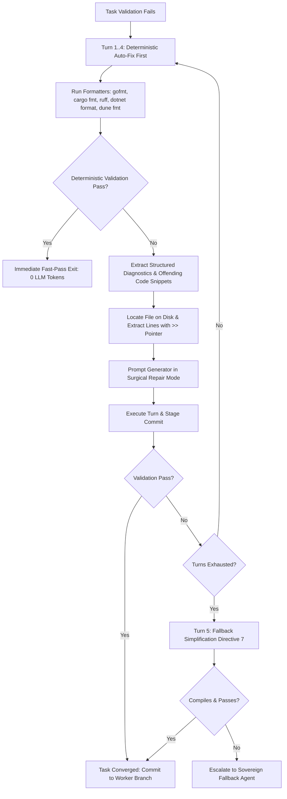

# Multi-Loop Orchestration & Dark Factory Quality Architecture

`noctifab` utilizes a multi-loop execution architecture to achieve high-resilience autonomous software delivery. In unattended dark factory runs, complex systems cannot always be fully implemented in a single linear pass. The multi-loop engine provides autonomous self-healing, progressive convergence, whole-workspace regression guarding, and strict quality verification.

---

## Key Principles

1. **Backlog Iteration Guarantee**: In each loop pass ($1 \dots N$), Noctifab iterates through 100% of discovered user stories in `roadmap/user-stories/`. A failure in an intermediate story records diagnostic telemetry but does not halt the loop, allowing downstream stories to be attempted.
2. **Two-Stage Story Verification**: A user story is only finalized as `StorySuccess` when:
   - **Stage 1 (Task Integrity)**: 100% of planned tasks achieve `TaskSuccess`.
   - **Stage 2 (DoD & Behavioral Review)**: The `StoryQAAuditor` verifies that the generated codebase satisfies all Definition of Done (DoD) criteria and passes both E2E test suites and whole-workspace regression checks.
3. **Automated Story Refinement**: If a story is incomplete or missing DoD features, Noctifab automatically enriches `roadmap/user-stories/<story>.md` with a `## Refined Acceptance Criteria & Missing Requirements` section and queues a targeted remediation task for the worker pool.
4. **Whole-Workspace Regression Guarding**: In Loop $k \ge 2$, before finalizing any story, the test validator executes the entire repository's test suite (`go test ./...`, `pytest`, `cargo test`, `npm test`, or `make test`) to guarantee changes in shared packages didn't break earlier modules.
5. **Loop Stagnation Circuit Breaker**: If Loop $k+1$ generates 0 codebase mutations and repeats identical failure signatures as Loop $k$, the orchestrator detects stagnation and terminates early to prevent token waste.
6. **Early Convergence Exit**: If all user stories in the backlog achieve verified `StorySuccess` on Loop $k$, Noctifab completes immediately without burning tokens on remaining loops.
7. **Generator-Tester Oscillation Circuit Breaker**: During intra-task multi-turn execution, if a task records $\ge 2$ consecutive passing test suites with 0 errors, $\ge 2$ consecutive turns have only modified test files with unchanged `src/` production code, and task progress is $\ge 70\%$, the orchestrator halts redundant test cosmetic churn and forces the task forward to review and completion.
8. **Global Task DAG & Cross-Story Pipelining**: Within and across iteration loops, task scheduling is evaluated across the entire project graph. Downstream user stories (e.g. `US-002`) unblock their tasks concurrently as soon as prerequisite foundation/interface tasks (e.g. `US-001-TASK-001`) merge into `main`, eliminating idle serialization and allowing multi-story implementations to progress in parallel.
9. **Whole-Project Acceptance & Behavioral Contract Audit Gate**: After all user stories and story-level QA evaluations pass, Noctifab invokes the `AcceptanceAuditor`. The auditor executes the project's black-box E2E test suite (`docker-compose.e2e.yml`, `make e2e`, or configured test commands) and audits the running codebase against the root `SPEC.md`. It verifies that every required command, endpoint, and behavior is verified by genuine, non-tautological tests. If any specification gaps or tautological tests are detected, Noctifab injects an actionable remediation task (`spec-remediation-<n>`) into the internal orchestrator loop. If contracts remain unfulfilled after remediation cycles, the build fails cleanly (`exit 1`), enabling outer autonomous feedback loops to intervene.
10. **Streaming Story DAG Synchronization**: During Loop 1, `StoryDAGScheduler` runs concurrently with multi-pass Product Manager roadmap generation. `Execute()` waits on a streaming barrier until Pass 1 emits user stories or closes the stream, and subsequent Pass 2/3 audits update story metadata in-place without resetting `RUNNING` or `SUCCESS` stories back to `PENDING`. Once roadmap generation finishes (`<-roadmapDoneCh`), `storyFiles` is synchronized to the full set of generated `roadmap/user-stories/*.md` files (removing the initial `SPEC.md` placeholder) before `RunWholeProjectAcceptanceGate` executes.

---

## Layered E2E Testing & Quality Architecture

Noctifab enforces a **defense-in-depth ("layered fallback")** strategy for End-to-End (E2E) integration testing. This ensures that integration failures are detected and resolved as early as possible without prematurely blocking intermediate tasks on future, unimplemented features.

```
┌─────────────────────────────────────────────────────────────────────────────────────────┐
│  1. Whole-Project Acceptance Audit Gate (AcceptanceAuditor)                             │ <- Runs FULL E2E against SPEC.md at project conclusion
├─────────────────────────────────────────────────────────────────────────────────────────┤
│  2. Post-Pipeline Sovereign Rescue Agent (start_sovereign_rescue)                       │ <- Runs FULL E2E on rescue turns if any story failed
├─────────────────────────────────────────────────────────────────────────────────────────┤
│  3. Story QA Completeness Gate (StoryQAAuditor)                                         │ <- Runs FULL E2E at the end of each completed user story
├─────────────────────────────────────────────────────────────────────────────────────────┤
│  4. In-Loop Fallback Agent (RunFallbackAgent)                                           │ <- Runs FULL E2E on task stalls, retries exhausted, or sovereign directives
├─────────────────────────────────────────────────────────────────────────────────────────┤
│  5. QA & Spec Remediation Tasks (qa-remediation-*, spec-remediation-*)                  │ <- Runs FULL E2E before declaring remediation task green
├─────────────────────────────────────────────────────────────────────────────────────────┤
│  6. Generator-Tester Loop (TestValidator.ValidateTask)                                  │ <- Runs FEATURE-SCOPED E2E: in-scope failures enforced;
│                                                                                         │    out-of-scope downstream failures ignored
└─────────────────────────────────────────────────────────────────────────────────────────┘
```

### 1. Whole-Suite E2E Enforcement Points
In the following gates, the **entire E2E test suite** (`make e2e`, `docker compose.e2e.yml`, or custom commands) is executed and strictly enforced:
- **Story QA Auditor (`StoryQAAuditor`)**: Executed after all tasks of a user story achieve `TaskSuccess`. Verifies that the completed story integrates with the system and passes the full E2E suite.
- **In-Loop Fallback Agent (`RunFallbackAgent`)**: Triggered when a task stalls, exhausts retries, or encounters QA deadlocks. Evaluates full E2E tests on each sovereign repair turn, rejecting turns where integration fails.
- **Post-Pipeline Sovereign Rescue (`start_sovereign_rescue`)**: Activated if any story remains unfulfilled after pipeline completion. Mandates full E2E execution and anti-stub quality gating on every turn.
- **Whole-Project Acceptance Gate (`AcceptanceAuditor`)**: Evaluated at the finale of the run against `SPEC.md`. Requires full E2E verification across all system commands.
- **Remediation Tasks (`qa-remediation-*`, `spec-remediation-*`)**: Created specifically to resolve audit gaps; every failure is considered in-scope and must be fixed before the task passes.

### 2. Feature-Scoped E2E in the Generator-Tester Loop
During intra-task execution in the generator-tester loop (`TestValidator.ValidateTask`):
- When unit tests pass, `TestValidator` evaluates detected E2E tests for tasks targeting integration files, final tasks in a story, or tasks with E2E directives.
- **Scope Filtering (`isE2EFailureInScope`)**: Noctifab parses failure traces from test runners (Pytest, Go test, Cargo, generic runners) and checks failing test names/files against the **active feature scope** (story ID, target files, and feature keywords).
- **In-Scope Failures**: If a failure corresponds to the active feature under development, `ValidateTask` returns `Passed: false` with the failure log, entering the orchestrator's autonomous **Closed Convergence Repair Loop**.
- **Out-of-Scope Failures**: If the E2E suite reports failures in downstream features that have not yet been developed (e.g. `Hashes` or `PubSub` failing while developing `US-001 Connection & Ping`), the failure is logged and safely ignored in the task loop (`⚠️ Orchestrator: Task ... E2E failure(s) are outside the scope of active feature; ignoring out-of-scope failure`). This guarantees forward momentum without masking errors in the current feature.

---

## Autonomous Multi-Turn Closed Convergence Repair Loop

In unattended factory operation, ad-hoc single-pass repairs fail when compiler runs contain cascaded errors, subtle syntax mismatches, or missing build targets. Noctifab implements an autonomous, multi-turn closed convergence loop (`pkg/services/orchestrator_convergence_loop.go`) that iteratively drives failing tasks to compilation and test success.



### 1. Deterministic Auto-Fix Pre-Step
Before expending LLM context or turns, the convergence loop invokes `runDeterministicAutoFixes` on the active worktree. It executes language-specific deterministic formatters:
- **Go**: `gofmt -w .`
- **Rust**: `cargo fmt --all`
- **Python**: `ruff format .` / `black .`
- **C#**: `dotnet format`
- **OCaml**: `dune fmt`
- **C / C++**: `clang-format -i`
- **Ruby**: `rubocop -A`
- **JavaScript / TypeScript**: `prettier --write .`

If the deterministic formatter resolves the issue (e.g. formatting violations, simple syntax layout), validation passes immediately with **zero LLM turns** consumed.

### 2. Multi-Language Diagnostic Parsing (`pkg/services/error_formatter.go`)
If deterministic fixes do not satisfy validation, the diagnostic engine extracts precise error locations and codes across language toolchains:
- **C# Roslyn**: `Board.cs(20,50): error CS0206` $\rightarrow$ File: `Board.cs`, Line: `20`, Col: `50`, Message: `CS0206...`
- **Rust Cargo / rustc**: `--> src/main.rs:12:5` $\rightarrow$ File: `src/main.rs`, Line: `12`, Col: `5`, Category: `Rust Compiler Error`
- **OCaml Dune / ocamlc**: `File "lib/engine.ml", line 44, characters 12-25:` $\rightarrow$ File: `lib/engine.ml`, Line: `44`
- **Java / Kotlin**: `App.java:23: error:` or `App.java:[23,15]` $\rightarrow$ File: `App.java`, Line: `23`
- **TypeScript / JavaScript**: `src/index.ts:14:5 - error TS2322` $\rightarrow$ File: `src/index.ts`, Line: `14`
- **Make**: `make: *** No rule to make target 'build'. Stop.` $\rightarrow$ File: `Makefile`, Target: `build`
- **Cargo**: `failed to select a version for requirement 'inkwell = "^0.5.1"'` $\rightarrow$ File: `Cargo.toml`, Dependency Error
- **Go / C / Generic**: `file.go:42:15: undefined: Bar` $\rightarrow$ File: `file.go`, Line: `42`
- **Python**: `File "src/server.py", line 45` and `FAILED tests/test_core.py::test_eval`

### 3. Offending Code Snippet Extraction Engine (`pkg/services/offending_code_extractor.go`)
Rather than expecting the LLM to search for or imagine the failing lines, `ExtractOffendingCodeSnippets` locates the file on disk (falling back to recursive directory search by basename if relative paths differ) and constructs an instructive contextual block:
- Shows 5 context lines before and after the failure.
- Inserts line numbers for accurate `edit_file` targeting.
- Places a high-contrast visual pointer (`>>`) on the exact offending line:

```csharp
File: src/Board.cs (around line 11)
Diagnostic: [C# Compiler Error] CS0206: A property or indexer may not be passed as an out or ref parameter
```csharp
      9 |         public void MakeMove() {
     10 |             int result = 42;
>>   11 |             UpdateState(ref this.CurrentTurn, out this.Winner);   <-- OFFENDING CODE
     12 |         }
```
```

### 4. Closed-Loop Multi-Turn Iteration
The loop executes up to 4 turns:
1. Turn 1 repairs the primary diagnostic error.
2. If a secondary error or lingering assertion emerges, Turn 2 re-extracts the updated diagnostics and new offending code context from disk.
3. Every turn stages and commits its progress to the worker branch, tracking incremental progress.

### 5. Fallback Simplification (Directive 7: Resilience & Forced Compilation Mandate)
If standard convergence turns (1..4) fail to eliminate errors, Turn 5 executes a **Fallback Simplification**:
- The prompt instructs the Generator to simplify complex type constructs, eliminate circular references, and provide a minimal, cleanly compiling implementation.
- In accordance with Directive 7, code must never be left broken; forced compilation guarantees the build compiles cleanly before escalating.
- If simplification also fails, the orchestrator safely escalates to the `FallbackAgent`.

### 6. Unrecoverable Environment Error Discrimination
The watchdog distinguishes genuine host environment failures (`FailureSandbox`, e.g. Docker daemon down, missing host GCC) from project manifest issues:
- Missing crate dependencies in `Cargo.toml` or missing targets in `Makefile` are classified as project manifest defects and passed into the convergence loop for repair.
- Only true container/toolchain daemon crashes fast-abort, preventing premature abandonment of repairable tasks.

---

## Configuration

In `.noctifab/config.yaml`:

```yaml
runtime:
  loop:
    count: 3                # Number of iteration loops (defaults to 1)
  max_tokens: 500000        # Global token consumption boundary
  max_duration: "10m"       # Total execution time limit
```

*(Note: Legacy `runtime.loops: 3` is also supported for backwards compatibility).*

### Product Manager Backlog Sizing
The total number of user stories created for the project is configured independently from loop execution passes:

```yaml
agents:
  product_manager:
    user_stories:
      max_count: 5          # Maximum user stories in roadmap (default: 5)
      complexity:
        min: 15             # Minimum target complexity units per story
        max: 35             # Maximum target complexity units per story
    passes: 2               # PM refinement passes
```

---

## CLI Multi-Loop Override

Override the configured loop count directly from the command line using the `--loops` / `-L` flag:

```bash
# Execute with 3 iterative loops
noctifab start . --loops 3

# Resume from first incomplete story with 2 loops
noctifab resume . -L 2
```

---

## Multi-Loop Convergence Matrix

Execution reports (`output/report/<TIMESTAMP>_<PROJECT>.md`) and the Web Dashboard (`GET /api/v1/convergence`) provide a dedicated **Convergence Matrix** table:

```markdown
## Multi-Loop Convergence Matrix

| Loop # | Stories Attempted | Stories Succeeded | Remediations Triggered | Tokens Used | Duration | Outcome |
| :--- | ---: | ---: | ---: | ---: | :--- | :--- |
| **Loop 1** | 4 | 3 | 2 | 125000 | 3m 12s | FAILED |
| **Loop 2** | 1 | 1 | 1 | 45000 | 1m 5s | SUCCESS |
```
